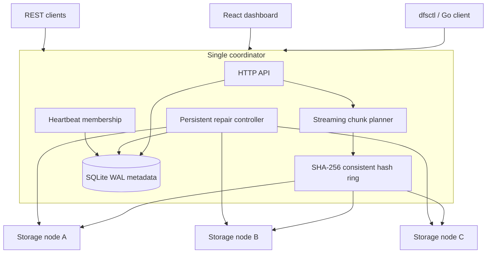

# Distributed File Storage

A fault-tolerant distributed object storage system built from scratch in Go.

A self-hosted learning and portfolio project: the coordinator splits streams into
SHA-256-addressed chunks, places distinct replicas using its own consistent hash
ring, and publishes immutable manifests only after strict replica acknowledgements.
Storage, placement, replication, and recovery are implemented here; this does not
wrap S3, MinIO, HDFS, or Ceph.

**Scope:** one authoritative SQLite coordinator, trusted local operators, no
coordinator HA, consensus, multi-tenancy, or production-readiness claim. Storage-node
failures can be tolerated while readable copies remain. The coordinator remains a
single point of failure.

## Quick start

Requires Go **1.26 or newer** (developed with 1.26.3), Node 24 for the dashboard,
or Docker Compose v2 with a running daemon. No Prometheus server is required.

```sh
go mod tidy
go build -o bin/coordinator ./cmd/coordinator
go build -o bin/storage-node ./cmd/storage-node
go build -o bin/dfsctl ./cmd/dfsctl
```

Run these in separate terminals, from the project root:

```sh
./bin/coordinator -config configs/coordinator.yaml
./bin/storage-node -config configs/node-1.yaml
./bin/storage-node -config configs/node-2.yaml
./bin/storage-node -config configs/node-3.yaml
```

On Windows, build with `.exe` output names and use `./bin/dfsctl.exe`. The supplied
configurations use a **public demo token** to make the local walkthrough reproducible.
For a private cluster, set the same random `DFS_INTERNAL_TOKEN` (16+ characters) in
all four process environments; it overrides the YAML value. Never reuse the demo
token on an exposed network.

Wait until `GET http://127.0.0.1:8080/ready` returns 200. Then:

```sh
./bin/dfsctl upload ./README.md --name readme.md --key readme-first
./bin/dfsctl list
./bin/dfsctl download FILE_ID --output restored.md
./bin/dfsctl verify FILE_ID
./bin/dfsctl nodes
./bin/dfsctl replication status
```

Dashboard:

```sh
npm --prefix web ci
npm --prefix web run dev
```

Open **http://127.0.0.1:5173**. The development server proxies `/api` to the local
coordinator. Its Overview, Files, Nodes, Replication, and Cluster pages use actual
backend data and refresh every five seconds. It supports uploads, downloads,
deletion, file search, manifest inspection, queue inspection, and physical membership
visualization. The ring picture is labeled schematic; it does not invent vnode
positions. There are no fabricated activity records or usage figures.

## Architecture



The coordinator owns manifests, upload sessions, node records, replica validity,
and repair tasks. Nodes own only bytes, their stable identity file, and a safe
hash-based chunk tree. Clients do not choose storage paths or placement.

## Features and implementation boundaries

| Area | Implemented behavior |
|---|---|
| Chunking | Fixed 1/4/8/16 MiB, 4 MiB default, sequential streaming |
| Integrity | SHA-256 per chunk and whole file; verify before forwarding a chunk |
| Placement | Handwritten SHA-256 ring, 128 configurable vnodes, distinct node IDs and unique addresses |
| Writes | Strict requested replica count; no degraded-write success |
| Metadata | SQLite WAL/FULL transactions, numbered migrations, immutable versions |
| Membership | Authenticated registration, exact address allowlist, persistent identities and heartbeats |
| Recovery | Alternate-replica reads, persistent repair jobs, bounded worker pool, backoff |
| Rebalance | Add desired copies after joins; retain old copies conservatively |
| Drain | Stop new placement, copy elsewhere, report remaining chunks and safe-to-remove |
| GC | Explicit mark/sweep, dry-run by default, grace period and upload/repair leases |
| Capacity | Configured quota and OS disk availability on Linux/Windows, logical/physical distinction |
| Operations | JSON slog, Prometheus text metrics, readiness, cancellation and shutdown |
| UX | Go CLI, streaming Go client, React/TypeScript/Vite dashboard |
| Deployment | Non-root Docker images, three persistent node volumes, optional fourth node |

## Chunking and content addressing

For a 13 MiB file with 4 MiB chunks the manifest records 4, 4, 4, and 1 MiB in
sequence. Each ID is lowercase hex `SHA256(chunk_bytes)`, independent of filename,
offset, or owner. Identical chunks share one path per node; manifests retain each
occurrence, including repeated chunks inside a single file. The complete-file hash
is computed over the original byte stream, **not** over concatenated chunk hashes.

Payload memory is bounded by chunk size and configured concurrency. Metadata is
O(number of chunks): this version keeps each upload manifest and inventory in memory.
It does not claim constant total memory for infinitely many chunks or files.

## Consistent hashing and replica placement

`internal/placement` hashes `node_id:virtual_index` with SHA-256, takes the first
64 bits in big-endian order, and sorts with a deterministic node-ID tie break.
A chunk key is hashed the same way; binary search finds its successor. The walk
wraps around, skips already selected physical IDs, and takes the first eligible
nodes. Map iteration never determines placement. Addition/removal rebuilds a ring
from the current healthy membership. Uploads skip targets whose latest reported
free space is too small; nodes enforce capacity again during PUT.

## Upload protocol and acknowledgements

`POST /api/v1/files?name=photo.jpg` accepts raw file bytes, **not multipart**.
An optional `X-Content-SHA256` supplies an expected full-file checksum. Optional
`Idempotency-Key` pins retries to the same committed immutable version.

1. Validate the name and limits; reserve a bounded operation slot and GC read lease.
2. Persist an INITIATED session, then mark UPLOADING.
3. Read one chunk, compute its ID, track it, select distinct targets, and PUT bytes.
4. Each target streams into a temporary file, verifies SHA-256, fsyncs, and renames.
5. Record each actual successful replica acknowledgement.
6. Mark VERIFYING; atomically insert the manifest and ordered references, then mark
   the session COMMITTED in the same SQLite transaction.
7. Return 201 only after commit. Failed requests never publish a partial file.

A retry of a committed key returns 200 and its original version. Pending or failed
keys return 409; resumable sessions are not implemented. Restart changes unfinished
sessions to FAILED. Use a new key to start a new attempt. As with many idempotency
APIs, a reused committed key identifies the original operation even if new bytes
are supplied; do not reuse a key for another logical upload.

Failed writes can leave orphan bytes. No eager rollback deletes shared content;
the administrative collector later removes unreferenced chunks safely.

## Download protocol and integrity

The coordinator reads a committed immutable manifest, walks chunks in order, and
rotates the starting replica deterministically with an atomic round-robin counter.
Each replica request has a deadline; attempts are bounded by the recorded replica
count. A chunk is buffered up to its declared size plus one byte and SHA-256
verified **before** any of its bytes reach the client. Invalid replicas are marked
invalid, counted, and replaced through the next repair scan.

Earlier verified chunks may already have been sent if a later chunk becomes
unavailable. The response declares `Trailer: X-DFS-Integrity`; only a completely
verified stream ends with `X-DFS-Integrity: verified`. It also exposes
`X-Content-SHA256`. A late error cannot change an already-sent HTTP 200. The Go
client pins a version, checks length, whole-file SHA-256, and the trailer. CLI
downloads use a temporary file and rename only after success. Browsers following
the raw download link do not perform this final application-level check; use
`dfsctl download` for verified restoration. Proxies must preserve HTTP trailers;
the nginx configuration explicitly enables this.

## Membership, heartbeats, and failure detection

Nodes persist `node-id` and refuse to start on another node's directory.
Registration requires the shared bearer token and an exact configured URL;
redirects and environment proxies are disabled in coordinator-to-node requests.
Duplicate IDs at different URLs and duplicate URLs under different IDs are rejected.

`JOINING → HEALTHY → SUSPECT → OFFLINE` is the normal path. A gap longer than
`failure_timeout` causes SUSPECT; twice the timeout causes OFFLINE. A returning
SUSPECT/OFFLINE node enters JOINING. A restarted coordinator treats loaded members
as JOINING, reconciles inventories and verifies every previously recorded chunk
on that node before considering it healthy. Missing or corrupt recorded replicas
are invalidated. Unrecognized inventory entries remain orphans, not trusted data.
The coordinator's receive time is authoritative; clocks need not be synchronized.

Detection is imperfect. A partition or a slow disk can resemble failure. Metadata
and node records are not deleted merely because a heartbeat is missed. SUSPECT and
DRAINING copies may still serve verified fallback reads, but only HEALTHY copies
count toward the replication-health target.

## Replication, repair queue, and self-healing

Maintenance periodically computes desired placement for every live chunk and
persists missing `(chunk,target)` tasks. The database uniqueness constraint prevents
duplicate active work for the same target. Pending work is capped at 10,000 tasks;
there are no per-chunk background goroutines or unbounded in-memory queues.

Each worker waits a size/rate budget, reads a verified healthy source, PUTs a
replacement, and records it only after a real acknowledgement. The default budget
is 16 MiB/s per worker with at most a chunk-sized burst per worker. Aggregate work
is bounded by worker count, but interactive traffic has no bandwidth reservation.
Failures back off exponentially (2 seconds initially, capped at 1,024 seconds),
then become FAILED after `max_retries`. Failed tasks remain visible; restart does
not reset their exhausted retry count. RUNNING jobs return to PENDING on restart.

With three physical nodes and one lost node there are only two healthy copies;
status stays degraded. Joining a fourth eligible node allows a verified replacement.
No source, no healthy target, insufficient capacity, and transport errors do not
create fictitious replicas. Tasks and complete error strings are exposed in the API.

## Rebalancing and draining

Joining/removing a healthy member changes desired ring placement. Maintenance
adds missing desired copies through the same repair mechanism. **Extra copies are
retained**, avoiding risky automated deletion at the expense of disk overhead.
The collector does not remove extra copies of a still-referenced chunk.

```sh
# Set DFS_INTERNAL_TOKEN in this terminal first.
./bin/dfsctl node drain storage-02
```

Drain returns 202 and `safe_to_remove`, plus a count of chunks still awaiting enough
healthy replacements. Repeat to inspect progress. It never reports safe while live
data relies on that node to meet the configured healthy-copy target. DRAINING state
survives heartbeat/restart and prevents new placements. Cancellation/undrain is
future work; plan membership changes deliberately.

## Immutable file versions

```sh
./bin/dfsctl upload report.pdf --name report.pdf
./bin/dfsctl upload new-report.pdf --name report.pdf --file-id FILE_ID
./bin/dfsctl download FILE_ID --version 1 --output old-report.pdf
```

Versions belong to an explicit file ID, not globally unique filenames. Different
uploads with the same name create different IDs unless `--file-id` is supplied.
Commit allocates the next version transactionally. All versions remain referenced
until deleting the whole file ID; per-version deletion and retention policies are
future work. Chunk bytes are shared where content matches.

## Deletion and garbage collection

DELETE tombstones the file first. Reads and version lookup then return 404; existing
readers with an acquired manifest may complete. GC marks every chunk referenced by
**any version** of every nondeleted file, and sweeps only old unreferenced inventory
entries. It protects chunks in pending/running repair tasks. An exclusive lifecycle
lease excludes concurrent uploads and repair/reconciliation; if either is active,
GC returns 409 immediately for the operator to retry. This is a conservative
administrative collection, not a continuously running low-latency collector.

```sh
./bin/dfsctl delete FILE_ID
./bin/dfsctl gc             # dry-run, requires DFS_INTERNAL_TOKEN
./bin/dfsctl gc --apply     # explicit physical deletion after grace
```

Offline nodes are skipped and reconsidered after recovery. Interrupted sweeps are
repeatable: missing chunks delete successfully; metadata is invalidated only after
the node acknowledges deletion. Old metadata rows are retained for inspection.

## Capacity and configuration

Strict YAML decoding rejects unknown keys and invalid limits before startup.
See `configs/` for complete examples. Important knobs: `chunk_size`,
`replication_factor`, `virtual_nodes`, `heartbeat_interval`, `failure_timeout`,
`repair_interval`, `repair_workers`, `repair_bytes_per_second_per_worker`,
`max_retries`, `max_upload_bytes`, `max_concurrent_operations`, `gc_grace`, and
`allowed_node_addresses`. Restart a process to change configuration.

Reported node free bytes are the minimum of configured quota remaining and OS
available disk space on Linux/Windows. Node PUT enforces the quota under a write
mutex; full-disk errors never acknowledge success. Quotas are per node, not user
accounts. Existing files may require additional temporary space during PUT.
Capacity reports are heartbeat snapshots, so an upload may be rejected after a
partially completed replica write if availability changes.

Cluster logical bytes count latest active file versions. Physical bytes count all
stored chunk bytes, including retained versions, extra replicas, and orphans;
deduplication means neither value is always a simple multiple of the other.
`physical_to_logical_ratio` reports observed storage overhead (zero for an empty
logical catalog), not a promise of replica count. Aggregate free bytes sum latest
registered-node snapshots, including stale offline observations; `healthy_free_bytes`
restricts this sum to healthy nodes. Nodes sharing a filesystem can report overlapping
OS free space, so these figures are not independent reservations.

## REST API

| Method | Endpoint | Behavior |
|---|---|---|
| POST | `/api/v1/files?name=NAME[&file_id=ID]` | Raw streaming upload / next version |
| GET | `/api/v1/files` | Latest active file manifests |
| GET, DELETE | `/api/v1/files/{id}` | Metadata / tombstone whole file |
| GET | `/api/v1/files/{id}/download[?version=N]` | Verified chunk stream |
| GET | `/api/v1/files/{id}/versions` | Version numbers |
| GET | `/api/v1/files/{id}/versions/{version}` | Immutable version metadata |
| GET | `/api/v1/nodes` | Membership snapshots |
| GET | `/api/v1/cluster/status`, `/api/v1/cluster/health` | Capacity and member counts |
| GET | `/api/v1/replication/status` | Under-replication and persistent task records |
| GET | `/health`, `/ready`, `/metrics` | Liveness / strict-write readiness / metrics |
| POST | `/internal/nodes/register`, `/internal/nodes/heartbeat` | Authenticated membership |
| POST | `/internal/nodes/{id}/drain` | Authenticated draining/progress |
| POST | `/internal/gc[?dry_run=false]` | Authenticated collection; dry-run default |
| PUT, GET, HEAD, DELETE | `/internal/chunks/{sha256}` | Authenticated storage-node bytes |
| GET | `/internal/inventory` | Authenticated storage-node inventory |

Application errors use `{"error":"..."}`. HTTP routing errors retain Go's standard
responses. `/health` is liveness; `/ready` requires sufficient healthy write targets;
`cluster/health` is a summary, not a guarantee that every replica is readable.

## CLI reference

`DFS_ADDRESS` defaults to `http://127.0.0.1:8080`; use it to point at another trusted
coordinator. Subcommand flags follow the positional file path or file ID.

```text
dfsctl upload PATH [--name NAME] [--key KEY] [--file-id ID]
dfsctl list
dfsctl info ID
dfsctl download ID [--output PATH] [--version N]
dfsctl delete ID
dfsctl nodes
dfsctl cluster status
dfsctl replication status
dfsctl verify ID [--version N]
dfsctl node drain NODE_ID
dfsctl gc [--apply]
dfsctl benchmark [--size BYTES] [--requests N] [--concurrency N]
dfsctl version
```

## Observability and concurrency

Prometheus-compatible `/metrics` exposes upload/download success/failure counters,
corruption, replica work, under-replication, node counts, capacity, and transfer/repair
duration sums and counts. Counters are process-local and reset on coordinator
restart. Despite its historical `_total` name, `dfs_chunks_stored_total` is an
inventory snapshot gauge; it can decrease after GC. Duration sums/counts are
summaries without quantiles or histogram buckets. No Prometheus server is needed.

Requests use JSON `log/slog` with request ID, method, path, HTTP status and duration;
corruption logs include chunk/node IDs. File contents and tokens are never logged.
Background errors are logged. Node write serialization protects quota and atomic
replacement; reads are concurrent. The coordinator membership mutex does not span
network I/O. HTTP connection/header/transfer/shutdown timeouts are explicit; context
cancellation propagates into requests and workers.

## Docker Compose and failure demo

```sh
docker compose up --build -d
# API http://127.0.0.1:8080; dashboard http://127.0.0.1:5173
./bin/dfsctl upload ./README.md
./bin/dfsctl info FILE_ID          # inspect chunk IDs and replicas
./bin/dfsctl download FILE_ID --output first.md
./bin/dfsctl verify FILE_ID
docker compose stop storage-node-2
# Poll replication status until failure_timeout has elapsed; do not use fixed sleeps.
./bin/dfsctl replication status
./bin/dfsctl download FILE_ID --output degraded.md
docker compose --profile replacement up --build -d storage-node-4
# Poll until under_replicated_chunks is zero, then verify again.
./bin/dfsctl replication status
./bin/dfsctl verify FILE_ID
docker compose restart coordinator
# Poll /ready, then verify persistent metadata and bytes.
./bin/dfsctl list
./bin/dfsctl verify FILE_ID
docker compose down              # retains all named volumes
```

Docker services use health checks and named volumes, with only API/dashboard
loopback ports published. Compose uses `/health` for coordinator startup to avoid a
circular readiness dependency. The fourth node is opt-in via the `replacement`
profile. Do not use `down -v` unless intentionally destroying the demo data.

## Testing and benchmarks

```sh
go vet ./...
go test ./...
go test -race ./...               # requires CGO and a supported C compiler
go build ./...
go test ./internal/chunk -run '^$' -bench . -benchmem
./bin/dfsctl benchmark --size 8388608 --requests 20 --concurrency 4
npm --prefix web run build
```

Tests use temporary directories and loopback `httptest` servers, no external
services. They cover chunk boundaries/large streams, ring determinism and remapping,
atomic storage, quotas, invalid/unauthenticated requests, immutable versions,
transaction rollback, restart persistence, replica corruption/fallback, real node
loss/replacement, interrupted/cancelled uploads, shared chunks/GC leases/grace,
heartbeat updates, drain safety, repair backoff, and concurrent transfers.

On Windows, `scripts/smoke.ps1` builds and launches separate coordinator/node
processes, uploads a small file and a 32 MiB streamed file, verifies all checksums,
stops a node, waits for degraded status, starts a replacement, verifies repair,
restarts coordinator and a node, and runs the CLI benchmark. It stops only the
processes it created and retains ignored diagnostic artifacts under `.cache/`.
Add `-Dashboard` to check the development page and live API proxy on port 15173.
Generated payloads are removed afterward; `-KeepData` retains them for inspection.
Ports 18080 and 19001–19004 must be free.

The CLI benchmark streams a generated file, measures serial/concurrent uploads and
downloads, metadata lookup, and hashing, and reports MiB/s, requests/s, p50/p95/p99,
errors, file size, node count, and replication factor. It tombstones its files after
the run; GC reclaims their bytes later. Percentiles use the nearest-rank method;
small request counts are smoke measurements, not robust tail-latency estimates.
Upload time includes strict replicated
writes; isolated replication throughput is not separately reported. Repeated zero
content emphasizes deduplication, not sustained unique-data disk throughput. Local
loopback results are not multi-machine benchmarks. See
[verification.md](docs/verification.md) for actual observations and limitations.

## Security and consistency

The public API intentionally has no end-user authentication and allows deletion.
Bind it to loopback and use it only on trusted local networks. The dashboard proxy
only exposes `/api`; internal endpoints require the shared token and nodes are
not host-published by Compose. There is no TLS, tenant isolation, at-rest encryption,
or protection against a malicious credentialed cluster member. Run under a private
OS account with exclusive control of data directories. See [security](docs/security.md).

Single-coordinator commits are transactional and manifests immutable. A successful
upload means required distinct targets acknowledged verified atomic writes and the
SQLite manifest committed; it does not promise copies stay alive forever. Metadata
visibility follows SQLite transactions. Membership, capacity, repairs, and replica
counts are eventually observed. No distributed linearizability, coordinator failover,
or split-brain protection is claimed. Never run multiple coordinators against the
same metadata database or node cluster.

## Known limitations and future work

The single coordinator is the availability and throughput bottleneck. All file
payloads pass through it. Manifest/inventory/queue enumeration is not paginated;
metadata memory grows with object count. Uploading is not resumable. Repairs that
exhaust retries require operator intervention; there is no retry/undrain API yet.
Rebalancing retains excess replicas. GC is explicit and conservative. Corruption
is detected on reads/rejoin rather than by a periodic full scrub. Linux syncs
renamed shard directories; Windows guarantees file flush and atomic publication,
but power-loss directory durability is not claimed. Data paths must be locally
controlled; this is not a sandbox against another OS user rewriting the storage
tree concurrently. Disk availability reporting is implemented for Linux/Windows;
other platforms enforce configured quotas only.

Future improvements: paginated inventory and manifests, resumable uploads,
administrative repair retry/undrain, periodic scrubbing, safe excess-replica pruning,
retention policies, rate-limited foreground traffic, TLS and per-user authorization,
multi-machine benchmarks, and only then coordinator consensus/replication.

## Engineering lessons illustrated

Content addressing simplifies identity but makes ownership and collection a metadata
problem. Replica count is evidence from real writes, not the requested replication
factor. Failure detection is suspicion, not proof. Streaming integrity needs a
per-chunk staging boundary and a client-visible final verification signal. Local
atomicity and replicated acknowledgements do not remove coordinator availability
limits. Tests at these boundaries are more valuable than superficial feature count.

## Project layout and further reading

```text
cmd/{coordinator,storage-node,dfsctl}/   executable entry points and CLI benchmark
internal/chunk/                        SHA-256 and bounded streaming
internal/config/                       strict YAML validation
internal/coordinator/                  API, membership, placement, repair, GC, metrics
internal/metadata/                     SQLite migrations and transactional manifests
internal/model/                        typed file, chunk, node and repair records
internal/placement/                    handwritten consistent hash ring
internal/storage/                      authenticated atomic chunk store and heartbeat client
internal/transport/                    HTTP timeouts, auth, logging and shutdown
pkg/client/                            streaming verified Go client
web/                                   React/TypeScript/Vite dashboard
configs/                               local and container configurations
scripts/                               verification and process-level smoke demo
docs/                                  architecture, security, recovery and verification
Dockerfile.coordinator / Dockerfile.node / docker-compose.yml
```

- [Architecture and consistency boundaries](docs/architecture.md)
- [Replication, membership, and rebalancing](docs/replication.md)
- [Storage format and crash behavior](docs/storage-format.md)
- [Failure recovery](docs/failure-recovery.md)
- [Security model](docs/security.md)
- [Verification evidence](docs/verification.md)
- [Suggested commit sequence](docs/commit-plan.md)

MIT licensed. No commits or pushes are performed automatically.
