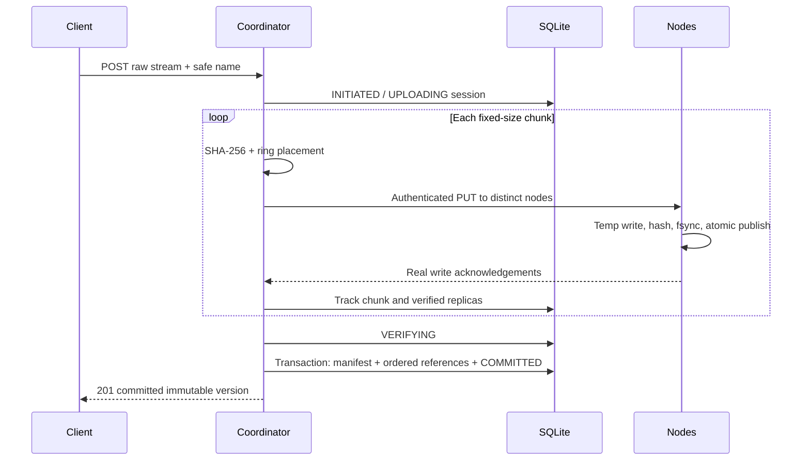
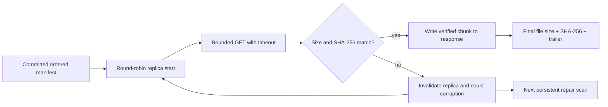

# Architecture and consistency

## Ownership

The single coordinator handles every public file operation. It stores typed file
manifests, chunk ownership references, replica validity, upload-session lifecycle,
node identity/address/state, and repair tasks in SQLite. Storage nodes hold raw
chunk bytes; they do not infer file ownership. `pkg/client` streams input and
validates restored output. The dashboard uses the same REST endpoints.

The SQLite transaction is the publication boundary. Individual chunk/replica
records may exist earlier, but they are not file manifests. Garbage collection
shares a lifecycle lease with uploads and maintenance, so those records cannot
cause premature physical deletion.

## Placement and membership

The ring is rebuilt from a sorted snapshot of eligible healthy node identities.
SHA-256 hash points use configurable virtual nodes; successor search and a
wraparound walk choose distinct physical IDs. The membership registry additionally
rejects two identities using the same endpoint. Capacity is an eligibility check,
not a reservation; the storage node is the final quota authority.

Heartbeats are persisted. Health is inferred from coordinator receive time.
JOINING prevents placement until recorded replicas are reconciled and read-verified.
SUSPECT/OFFLINE never deletes file manifests. Draining excludes new placement but
permits verified fallback reads while replacement copies are built.

## Reads and recovery

Retry count is bounded by manifest replica count. Data from a corrupt replica is
never forwarded. If all sources fail after earlier chunks were sent, the response
cannot change status; the absent/failed final integrity trailer tells the Go client
to reject the temporary download. The browser's raw link has weaker final-file
verification than the Go client and CLI.

Maintenance computes desired placement for every live chunk, queues missing target
copies, and executes a bounded worker pool. A repair reads a verified source,
writes the target, and then persists success. Extra copies are retained after
rebalance. No pruning algorithm claims an old copy is safe to delete.

## Concurrency and bounds

- Public upload/download slots bound concurrent payload buffers and network work.
- Upload holds one reusable payload buffer; download and repair buffer one chunk.
- The node write mutex covers quota accounting and disk mutation, not network calls
  to another service. Reads remain concurrent.
- The coordinator membership mutex covers node snapshots and local metadata only.
  It is never held across chunk transfer calls.
- One maintenance cycle runs at a time; `repair_workers` goroutines consume an
  unbuffered work channel. Pending persistent tasks are capped at 10,000.
- GC takes a nonblocking exclusive lifecycle lease. Uploads and repair hold read
  leases; active work causes GC to return a retryable conflict.
- File manifests, inventories and task enumeration grow with metadata size; v1
  does not offer pagination or constant total memory for an unlimited catalog.

## Consistency boundaries

There is exactly one authoritative coordinator. SQLite WAL with synchronous FULL
provides local transaction durability according to the filesystem's guarantees.
Successful upload acknowledges real verified writes to the required distinct
targets followed by a committed manifest. Versions do not mutate. GET pins a
manifest snapshot; deletion tombstones future readers, but a reader with a
previously acquired manifest may finish.

Membership and replica health are observations and become stale. A write
acknowledgement cannot guarantee a target remains alive after responding. A repair
may be physically complete before its metadata transaction is recorded; retrying
the content-addressed PUT is safe. Failed uploads leave collectible orphans.

The coordinator is a single point of failure. There is no leader election, Raft,
coordinator replication, distributed consensus, or HA. Running multiple coordinators
against the same database/cluster is unsupported and would invalidate lifecycle
and maintenance coordination. Back up metadata and bytes together for recovery.
