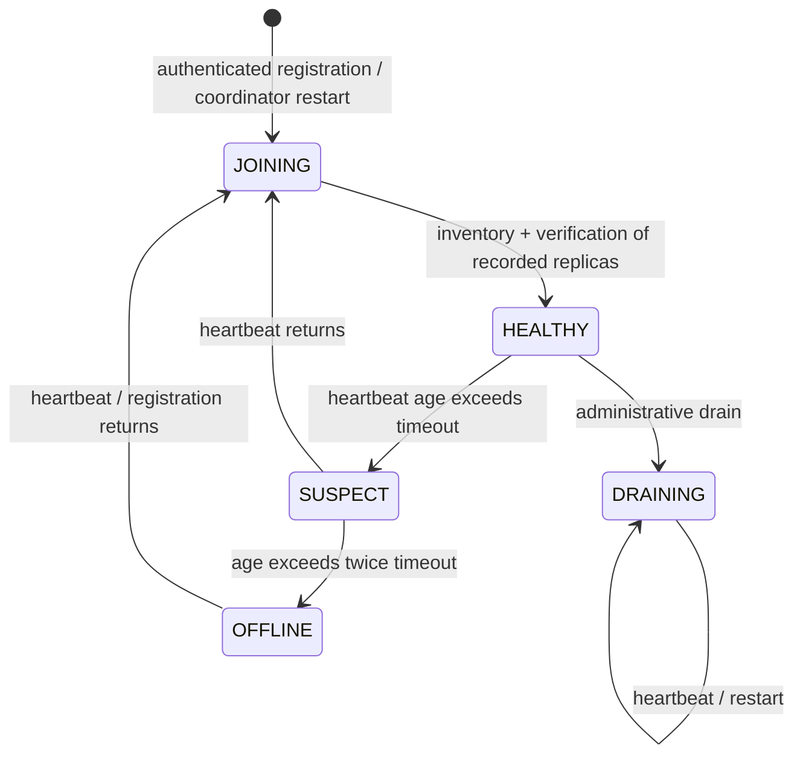
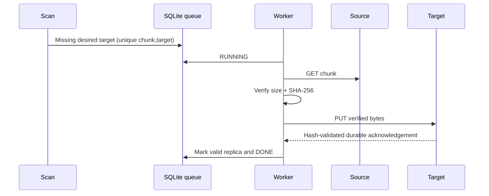

# Replication and membership

## Placement and acknowledgement

Default replication factor is three. Ring points are first 64 bits of SHA-256 over
`node_id:virtual_index`, with 128 virtual nodes per physical node by default.
Points are sorted; lookup uses binary search. A deterministic walk chooses distinct
physical nodes and never counts vnode duplicates. Registration also enforces unique
addresses. Ring addition/removal preserves unaffected successor choices.

Uploads attempt eligible targets with enough recently reported free space. They
acknowledge only when every required physical replica PUT succeeded and the
metadata transaction committed. A target's reported space is not a reservation;
node-side capacity enforcement can still reject a write. Partial success leaves
unpublished orphan bytes for conservative collection. There is no write quorum or
degraded-write mode masquerading as full replication.

## Failure detection

Registration provides identity, allowlisted URL, quota, and observed usage.
Heartbeat receive time is coordinator time. No missed heartbeat deletes a replica
record. HEALTHY copies count toward replication status; SUSPECT and DRAINING may
still be read after verification. OFFLINE and JOINING are not normal read targets.
These are imperfect failure detectors, not proof that a machine or disk is dead.

## Persistent repair queue

The repair task records ID, chunk, source, target, status, attempts, next-attempt
Unix timestamp, and last error. `(chunk_id,target_node)` is unique. Pending/running
work is capped at 10,000; a later scan fills newly available queue space.

`PENDING → RUNNING → DONE` is success. Failure increments attempts, persists the
error, and returns to PENDING after exponential backoff. After `max_retries`, the
task is FAILED and remains visible. Exhausted tasks require operator intervention;
there is no retry API in v1. A task that had DONE may be requeued if that verified
copy is later found corrupt or missing. Restart requeues RUNNING work and retains
attempt counts. Completed/failed history is retained and not yet compacted.

Workers are bounded by `repair_workers`. A pre-transfer pacing budget of
`chunk_size / repair_bytes_per_second_per_worker` limits sustained scheduled payload
rate with one chunk burst per worker. Source and destination traffic both consume
network bandwidth; the setting is payload scheduling, not a strict NIC rate shaper.
Each request uses a 30-second transfer timeout and parent cancellation.

If no healthy source exists, repair fails without producing a replica record.
If no replacement physical node exists, desired placement cannot create another
copy; under-replication stays visible. A cluster of two healthy nodes never reports
three healthy copies.

## Rebalance, drain, and node return

Joining changes the ring. Maintenance adds verified copies on desired targets
without blocking normal reads. Extra old replicas are retained. This is safe
copy-only rebalancing; disk overhead can exceed the replication factor until future
safe pruning is implemented.

Drain marks the node DRAINING, preserving that state across heartbeats/restarts.
New placement stops there. Repeated drain requests return current progress and
`safe_to_remove`. Safety requires the replication factor of healthy copies outside
the draining node for every referenced chunk still recorded there. Data that exists
solely there is never reported safe. With too few other nodes, progress waits.

On rejoin the coordinator obtains inventory and verifies every coordinator-known
replica by downloading and hashing it. Validity is updated per replica. Missing or
corrupted bytes are not silently trusted. Unknown inventory entries are orphans;
the coordinator does not adopt them as file ownership. A restarted coordinator
revalidates loaded members before accepting them as healthy.
